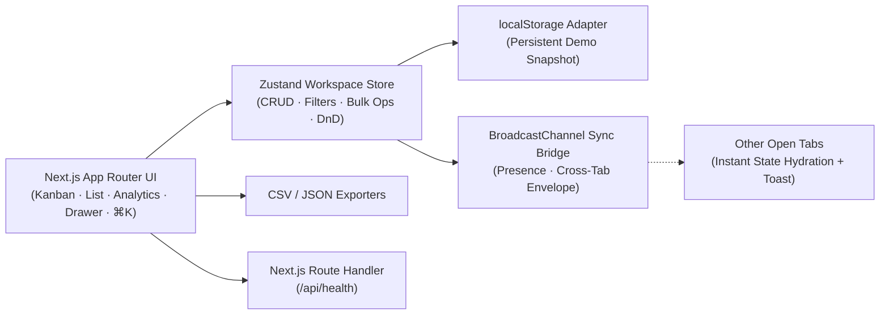

<div align="center">

# Orbit — Modern Issue & Project Workspace

**A keyboard-first, Linear-inspired project & issue tracker built with Next.js App Router, TypeScript, Tailwind CSS v4, `@dnd-kit`, Recharts, and real-time cross-tab synchronization.**

[](https://nextjs.org/)
[](https://www.typescriptlang.org/)
[](https://tailwindcss.com/)
[](https://zustand.docs.pmnd.rs/)
[](LICENSE)

</div>

---

## Highlights

- **Zero-Setup Instant Demo** — Ships with 3 realistic engineering projects (`Core Platform`, `Design System`, `Mobile Companion`), 18 detailed issues, subtasks, comments, and live cycle metrics persisted in `localStorage` with one-click demo reset.
- **Real-Time Cross-Tab Sync (`BroadcastChannel`)** — Open a mirror tab directly from the sidebar (`Open mirror tab`) and drag cards, post comments, or edit statuses to watch state synchronize across tabs in under 15ms with presence counting and remote-sync activity events.
- **Three Integrated Views**
  - **Kanban Board (`1`)**: Smooth drag-and-drop across columns and intra-column reordering powered by `@dnd-kit`, floating tilted drag overlay, column story-point totals, and inline quick-add.
  - **List & Triage (`2`)**: Group by Status, Priority, or flat sortable view; click-to-cycle status/priority icons; multi-select checkboxes with an animated floating **Bulk Action Bar** (batch status, priority, and delete).
  - **Sprint Analytics (`3`)**: Interactive Recharts **Cycle Burndown** area chart, **Workflow Distribution** bar chart, **Team Capacity & Allocation** stacked bars, Priority breakdown, and a live **Realtime Activity Stream**.
- **Slide-Over Issue Drawer with Deep Linking** — Inline editable title & description, interactive metadata pickers, subtasks checklist with progress bar, comment composer (`⌘↵`), delete-with-Undo toast, and shareable URL synchronization (`?issue=ORB-101`).
- **Keyboard-First Command Palette (`⌘K`)** — Powered by `cmdk` to fuzzy-search issues, jump between views/projects, filter urgent blockers, toggle themes, export CSV/JSON, and trigger workspace actions without lifting your hands from the keyboard.
- **Linear / Raycast Aesthetic** — Dark-first obsidian surfaces with 1px hairline borders, custom pixel-aligned SVG status rings and priority signal bars, Geist & Geist Mono typography, and a full flicker-free Light Mode toggle.

---

## Architecture



---

## Keyboard Shortcuts

| Shortcut | Action |
| :--- | :--- |
| `⌘ K` / `Ctrl K` | Open Command Palette |
| `C` | Create new issue modal |
| `1` / `2` / `3` | Switch between Board, List, and Analytics views |
| `[` | Collapse / expand sidebar |
| `?` | Open Keyboard Shortcuts cheat sheet |
| `⌘ ↵` / `Ctrl ↵` | Submit create-issue modal or post comment |
| `Esc` | Dismiss active modal, drawer, or bulk selection |

---

## Tech Stack

- **Framework:** Next.js 16 (App Router, Turbopack, Route Handlers)
- **Language:** TypeScript (strict mode)
- **Styling & Theme:** Tailwind CSS v4, CSS custom property design tokens, `next-themes`
- **Drag & Drop:** `@dnd-kit/core`, `@dnd-kit/sortable`
- **State & Persistence:** Zustand, `localStorage`, native `BroadcastChannel` API
- **Data Visualization:** Recharts
- **Animations & Overlays:** Framer Motion, `cmdk`, Sonner toasts, Lucide icons

---

## Getting Started

```bash
# 1. Install dependencies
npm install

# 2. Start the development server
npm run dev
```

Open [http://localhost:3000](http://localhost:3000) in your browser. Click **Open mirror tab** in the left sidebar to see real-time cross-tab synchronization live.

### Production Build

```bash
npm run build
npm run start
```

---

## Deploying to Vercel

Because Orbit requires zero external API keys or database provisioning for the instant demo mode, deploying to Vercel takes under 60 seconds:

1. Push this repository to GitHub.
2. Import the repository at [vercel.com/new](https://vercel.com/new).
3. Click **Deploy** — no environment variables required.

---

## Project Structure

```text
src/
├── app/
│   ├── api/health/route.ts       # Operational health Route Handler
│   ├── globals.css               # Tailwind v4 + Linear dark/light design tokens
│   ├── layout.tsx                # Geist fonts, ThemeProvider, Sonner Toaster
│   └── page.tsx                  # Workspace entry point
├── components/
│   ├── icons/                    # Bespoke Orbit logo, SVG status rings & priority bars
│   ├── layout/                   # Collapsible Sidebar & Filterable Header
│   ├── overlays/                 # Issue Drawer, Create Modal, ⌘K Palette, Shortcuts
│   └── views/                    # Kanban Board, List & Triage, Sprint Analytics
├── lib/
│   ├── constants.ts              # Status, Priority, Label metadata
│   ├── seed-data.ts              # Dynamic-date realistic sample dataset
│   ├── sync.ts                   # localStorage + BroadcastChannel realtime engine
│   └── utils.ts                  # Date formatters, RFC 4180 CSV & JSON exporters
├── store/
│   └── workspace-store.ts        # Central Zustand store & filtered selector
└── types/
    └── workspace.ts              # Strict TypeScript domain models
```
